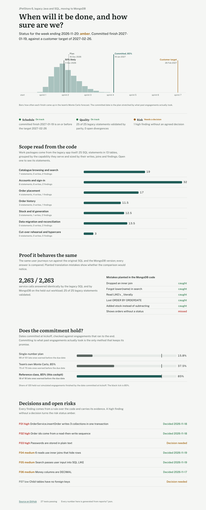

# modernization-delivery-cockpit

A delivery cockpit for moving a legacy Java application to MongoDB with GenAI-accelerated engineering, built on a real
application: [JPetStore 6](https://github.com/mybatis/jpetstore-6) (Java, MyBatis, SQL), copied unchanged into
`legacy/jpetstore`.

AI tooling can now convert a legacy application's code in hours. What still decides whether such an engagement
succeeds is the part around the conversion:

- **Scope you can defend:** what is in this application, and how big is the job?
- **Proof:** does the modernized system behave exactly like the old one?
- **A date that holds:** what finish can be committed to the customer?
- **Status leadership can trust:** what is the status, measured rather than asserted?

This repo does each of these on JPetStore, end to end:

| Step | What it does here |
|---|---|
| **Analyse** | Reads the MyBatis mappers, the DDL and the Java services. Lists every SQL statement, the tables it reads and writes, its joins, and which service methods are `@Transactional`. Rules over the code raise findings, each with its evidence. Statements are grouped into work packages by business capability and sized from their writes, joins and findings. |
| **Transform** | A MongoDB document model (orders with embedded line items and status; accounts with embedded profile and sign-on; inventory folded into items) and a repository that answers all 25 legacy statements from it. |
| **Migrate** | Moves every legacy table into the document model, with money as `Decimal128`. |
| **Validate** | Seeded user journeys (browse, search, sign up, log in, edit a profile, order, read back) run through a port of JPetStore's own service layer, once against the original SQL and once against MongoDB. Every answer is compared. To check the comparison itself, classic translation mistakes are planted in the MongoDB code: does parity notice them? |
| **Forecast** | A single-number plan, a Monte Carlo forecast from the team's assumptions, and a **reference-class** commitment (the plan stretched by what past engagements actually took). A rolling forecast from observed throughput warns when a commitment is slipping. All three are scored on simulated engagements whose truth the planners never see. |
| **Report** | RAG status from evidence (schedule against the target date, statements validated by parity, high findings without a decision), a decision log, and a weekly status report. The report has a number guard: every figure in a drafted narrative, for example one an LLM wrote, must appear in the facts it was drafted from. |

## Dashboard

Generated by `python -m mdc report` from `reports/*.json`; nothing between the markers is typed by hand.

<!-- dashboard:start -->
**Steering view, week ending 2026-11-20: AMBER**

| Area | Status | Evidence |
|---|---|---|
| Schedule | green | committed finish 2027-01-19 is on or before the target 2027-02-26 |
| Quality | green | 25 of 25 legacy statements validated by parity, 0 open divergences |
| Risk | amber | 1 high finding without an agreed decision |

Scope from the code: 7 work packages, 108.5 points. Finish 50% likely 2026-12-11; committed at 85% 2027-01-19; customer target 2027-02-26.

**Analysis of the legacy app** (JPetStore 6, unchanged): 25 Java files, 3,865 lines, 13 tables, 25 SQL statements (11 writes, 11 joins), 4 transactional service methods; 7 findings raised by rules, 3 of them high.

**Behavioural parity, held-out workload run once**: 2,263 of 2,263 service calls return the same result from MongoDB as from the legacy SQL; 25 of 25 legacy statements validated. The harness catches 5 of 6 classic translation mistakes planted in the MongoDB code; the one it misses is listed under Limits.

**Forecasting track record**: 120 held-out simulated engagements, run once, commitments made at kickoff:

| Commitment method | On time | Late, warned before the due date | Median warning lead | False alarms | Median buffer over the plan |
|---|---:|---:|---:|---:|---:|
| Single-number plan | 15.8% | 99 of 101 | 2.05 sprints | 6 | 0 sprints |
| Team's own Monte Carlo, 85th percentile | 37.5% | 75 of 75 | 2.56 sprints | 25 | 0.71 sprints |
| **Reference class from past engagements, 85th percentile** | 85% | 18 of 18 | 5.21 sprints | 23 | 4.03 sprints |

Forecast error (mean absolute, sprints): plan 2.03, Monte Carlo median 2.33, rolling forecast from observed throughput at sprint 3: 1.2.

Tests: 27 passed, 0 failed.
<!-- dashboard:end -->



The web dashboard (`web/`, React with Framer Motion) answers the steering question first: when will it be done,
and how sure are we? It then shows:

- the scope as the code defines it;
- the parity evidence;
- the forecasting track record;
- the findings with their decisions.

## How it fits together

```
legacy/jpetstore (Java, MyBatis XML, DDL, seed data; unchanged)
   │
   ├─ mdc.intake ── statements, tables, joins, @Transactional ─► findings (rules) ─► work packages (sized)
   │                                                                         │
   ├─ mdc.legacy ── the original SQL on SQLite (HSQLDB semantics kept)      ▼
   │        ▲                                                       mdc.forecast ◄── reference class ◄── mdc.engagements
   │  mdc.service (JPetStore's services, ported call for call)          │                (simulated past engagements)
   │        ▼                                                            ▼
   ├─ mdc.modern ── document model + repository on MongoDB        mdc.status ── RAG with reasons, weekly report,
   │                                                                            decision log, number guard
   └─ mdc.parity ── seeded journeys on both sides, every answer compared; mdc.mistakes keeps it honest
```

| Path | What it is |
|---|---|
| `mdc/intake.py` | Statement facts, service methods, rule-based findings, work packages |
| `mdc/legacy.py`, `mdc/modern.py` | The two data layers; `modern.connect()` uses `MONGO_URI` (CI runs MongoDB 7.0) or mongomock |
| `mdc/service.py` | AccountService, CatalogService and OrderService, as JPetStore wrote them |
| `mdc/parity.py`, `mdc/mistakes.py` | Workload generator, comparison, planted mistakes |
| `mdc/forecast.py`, `mdc/engagements.py` | Plan, Monte Carlo, rolling forecast; the simulated engagements and their scoring |
| `mdc/status.py` | RAG rules, weekly report, number guard |
| `config/` | `delivery.json` (team, estimate weights, forecast and status rules), `decisions.json`, `heldout.json` |
| `reports/` | Generated results, `weekly_status.md` and `REPORT.md` |

## Run it

```bash
pip install pymongo mongomock pytest
python -m pytest                          # 27 tests; set MONGO_URI to run them on a real MongoDB
python -m mdc intake                      # scope, findings, work packages
python -m mdc parity                      # dev workloads: legacy SQL against MongoDB
python -m mdc mistakes                    # does parity catch the planted mistakes?
python -m mdc engagements                 # dev engagements: the reference class
python -m mdc cockpit                     # forecast, RAG, weekly report
python -m mdc report                      # REPORT.md, this dashboard, web/public/data.json
cd web && npm ci && npm run dev           # the dashboard
```

CI runs the tests and the three dev workloads (3,255 service calls) against a real MongoDB 7.0 on every push.
Every call agrees.

## Held-out rule

The parity workloads and the simulated engagements come from seeded generators. The dev sets were used while
building. The held-out ones were locked by SHA-256 in `config/heldout.json` before anything ran on them, and run
once after the code was frozen. Their first runs, in `reports/heldout/`, are the numbers above. The reference
class used on the held-out engagements was computed from the dev engagements only.

## Limits

- **The legacy side runs on SQLite, not HSQLDB.** Two adjustments keep HSQLDB's behaviour: exact decimals stored
  as text, and a case-sensitive LIKE. Locally the MongoDB side runs on mongomock; CI runs the tests and the dev
  parity workloads against MongoDB 7.0. MongoDB 8.x does not start on the CI runners' Linux 6.19+ kernel yet
  (SERVER-121912).
- **Real MongoDB found a bug in the comparison.** The first CI run on real MongoDB showed that the
  comparison never applied its row-order rule. Results were compared exactly as returned, which is stricter
  than intended, so mongomock (which returns rows in insertion order) agreed by accident. The comparison is
  fixed: rows the SQL leaves unordered compare as a set, and ORDER BY results must keep their order. The
  held-out run, made under the stricter rule, stands.
- **Not every translation mistake is caught.** Parity catches 5 of the 6 planted ones. It misses *orders without
  a status are shown*, because no user journey creates such an order. Closing that needs a fault journey, for
  example a crash between the order and its status write.
- **Order placement is not yet transactional on the MongoDB side.** It runs statement by statement. The agreed
  decision (F01) is a single-document order plus a multi-document transaction on a replica set; that change is
  scoped, not built.
- **The engagements are simulated.** Their effort spread, scope discovery and capacity dips come from
  `config/delivery.json`, not from real project history, so the track record shows how each method behaves, not
  how a particular team performs. The reference-class commitment buys its reliability with buffer: a median of
  about 4 sprints over the plan. Its rolling warnings also raised 23 false alarms on engagements that finished on
  time.
- **JPetStore is small** (25 statements). The method scales by its rules and generators, not by hand-written
  cases, but a real enterprise application would also need stored procedures and batch jobs handled. This repo
  has none of either.

## Licence

MIT for this repo. `legacy/jpetstore` is JPetStore 6 by the MyBatis team, under the Apache License 2.0
(`legacy/jpetstore/LICENSE`, `SOURCE.txt`). "MongoDB" and "Atlas" refer to MongoDB, Inc.'s products. This is an
independent project, not affiliated with MongoDB.
